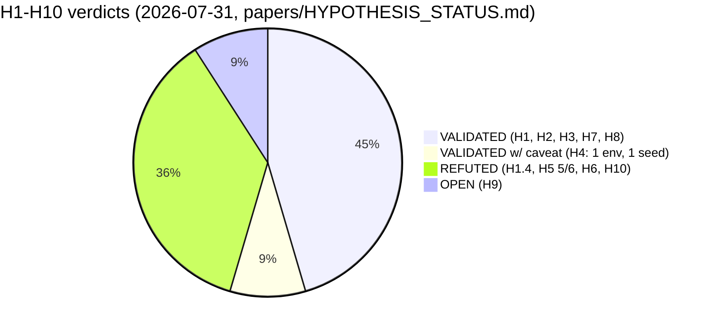

# Archimedes Project (AGI-2026-001)

[](LICENSE)  [](LICENSE)  [](https://github.com/aidless/agi-research/actions/workflows/ci.yml)

> 🗂 **仓库族谱**：「自主研究循环」主线仓是 [ai-researcher](https://github.com/aidless/ai-researcher)（工具/证据链）；本仓定位是五年期研究纲领（Archimedes Project），不是工具仓。

A 5-year independent research program toward a self-improving
AGI substrate. The central architectural claim: decoupling the
failure-prediction Monitor from the policy gradient enables
stable self-monitoring in single-agent RL, and this primitive
composes well with slot-attention world models and fuzzy
symbolic verification.

**Status (2026-07-31):** Y0 Q3 (1st quarter of Year 0). The
monitoring hypothesis is verified in single-agent RL (H1, H2),
REFUTED in multi-agent RL (H5, 5/6 pathways) and LLM self-
monitoring (H10, REFUTED at n=100 with d=+0.030). One
publishable positive result: v8 dlr_only (DLR in critic) gives
+0.06 at n=100 (p<0.05 with Bonferroni).

All numbers above are self-reported, in-progress results from a
solo project; they have not been externally reviewed.

## Publication status and scope

**No manuscript from this repository is publicly released.** The
project is under an active publication hold (`PUBLICATION_HOLD.md`):
drafts stay internal until a single bundled, thesis-style write-up
is ready. Venue names and cover letters under `papers/` are
*targets*, not submitted artifacts.

Scope of what is public here:

- **Research artifact** — `papers/`, `projects/*/code/`,
  `experiments_log/`, `thesis_draft_*.{tex,pdf}`, `ROADMAP.md`.
- **Workspace notes** — `community/`, `study_materials/`; drafts
  kept for convenience, not part of the research artifact.
- **Not in this repository** — personal application material
  (`phd_applications/`, `grant_applications/`) was removed from the
  tree; it is gitignored and must not be re-added here.

## Repository layout

```
agi-research/
├── papers/                        # All papers, cover letters, supplementary
│   ├── monitor_signal_vs_dlr_6pathway.md/pdf    # Y3 paper (AAMAS 2027 target)
│   ├── project_g_v0_5_h10_paper.md              # Y4 paper (COLM 2026 target)
│   ├── y5_monitor_transfer_synthesis.md         # Y5 cross-context synthesis
│   ├── y1_9hypothesis_framework.md              # Y1 H1-H9 framework
│   ├── HYPOTHESIS_STATUS.md                     # H1-H10 status table (this session)
│   ├── cover_letter_aamas2027.md                # AAMAS cover letter
│   ├── cover_letter_colm2026.md                 # COLM cover letter (this session)
│   ├── supplementary_materials.md              # S1-S12 reproducibility
│   ├── VENUE_PLAN.md                            # Y3+Y4 venue plan
│   ├── arxiv_submission/                        # arXiv package (5 figures, tar.gz)
│   └── figures_v2/                              # 7 PNGs (this session)
├── projects/
│   ├── project_a_self_improvement/code/         # Y1 implementation
│   ├── project_f_multi_agent/code/              # Y3 implementation (v3-v8)
│   └── project_g_llm_self_monitoring/code/      # Y4 implementation
├── experiments_log/                             # All experiment logs
│   ├── _h10_n20_*.log, _h10_n100_*.log          # H10 per-seed runs
│   ├── _h10_n20_bootstrap.json                  # H10 n=20 paired bootstrap
│   ├── _h10_n100_bootstrap.json                 # H10 n=100 paired bootstrap
│   ├── _v8_sanity_4seed.json                    # v8 dlr_only 3-seed replicate
│   ├── _run_h10_n20.ps1, _run_h10_n100.ps1      # Launchers
│   ├── 2026-07-28-PRE-REGISTERED-H10.md         # H10 pre-reg
│   └── 2026-07-28-v8-dlr-only-n100-aggregation.md
├── thesis_draft_v2.0.{tex,pdf}                  # Thesis v2.0 (66 pages, includes all Y1-Y5)
├── PROGRESS.md                                  # Session-by-session log
└── ROADMAP.md                                   # 5-year plan
```

## Key results (current session)

| Hypothesis | Status | Key result |
|---|---|---|
| H1: Decoupled Monitor > Joint Monitor (single-agent) | VALIDATED | n=15, t=6.76, p<0.001 |
| H2: Training-time Monitor > Inference-time | VALIDATED | n=15, p<0.001 |
| H5: Decoupled Monitor coordination in MARL | REFUTED (5/6) | v8 dlr_only +0.06 at n=100 (p<0.05 Bonf) is only publishable |
| H10: Decoupled Monitor to LLM self-monitoring | REFUTED at chance level | n=100, F-J d=+0.030, 95% CI [-0.087, +0.117] |
| v8 dlr_only 3-seed independent replication | direction-consistent | [+0.27, -0.08, +0.30], 2/3 positive |

## Quickstart (verify the numbers)

Every cross-document number can be re-checked in one command — the audit
cross-references Y1/Y3/Y4/Y5 papers, thesis, `HYPOTHESIS_STATUS.md`, cover
letters and this README against each other (57 consistency lines):

```bash
make audit PY=python3        # Makefile defaults to `python`; pass PY=python3 where no alias exists
```

Real output head (2026-11-10):

```text
============================================================
DATA AUDIT (v2: 10 sources)
============================================================

[H10 GSM8K n=20]
  -0.053: Y4_paper, Y5_paper, supplementary
  STOP-PAPER-REFUTED-REVERSE: Y4_paper, Y5_paper, HYPOTHESIS_STATUS
[Y1.3]
  6.76: Y1_paper, Y3_paper, Y4_paper, Y5_paper, thesis, HYPOTHESIS_STATUS, COVER_COLM, README
[v8 dlr_only n=100]
  0.0617: Y3_paper, Y5_paper, supplementary, thesis
  p=0.0433: Y3_paper, Y5_paper
Audit complete.
```

Any edit that breaks a number's consistency across documents fails this audit.

## Hypothesis verdict map (from papers/HYPOTHESIS_STATUS.md)



The full per-hypothesis table (statement, n, key result, source) lives in
[papers/HYPOTHESIS_STATUS.md](papers/HYPOTHESIS_STATUS.md); H5 and H10 both
carry pre-registration documents written before data collection
(`papers/supplementary_materials.md` §S11).

## Reproducibility

- Y3: `experiments_log/2026-07-29-y2-final-6-pathway.md` +
  per-seed JSONs in `projects/project_f_multi_agent/code/checkpoints/`
- Y4: `experiments_log/_h10_n{20,100}_bootstrap.json` +
  per-seed logs in `experiments_log/_h10_n{20,100}_*.log`
- pre-reg documents: `experiments_log/2026-07-28-*.md`
- Launchers: `experiments_log/_run_*.ps1`

## arXiv submission

The Y3 paper package is ready at `papers/arxiv_submission/`
and the Y4 paper figures are in `papers/figures_v2/`. Both
require an `ARXIV_TOKEN` environment variable to upload. Upload
is currently paused per `PUBLICATION_HOLD.md`.

## Citation

If you refer to this work, cite the drafts (not yet publicly
released — see `PUBLICATION_HOLD.md`):

- Liu, Z. (2026). The Failure-Prediction Monitor Does Not
  Transfer: A 6-Pathway Systematic Investigation of MARL
  Architectures. Manuscript draft; AAMAS 2027 target.
- Liu, Z. (2026). When Decoupling Does Not Help LLM
  Self-Monitoring Either: A Pre-Registered n=5/20/100
  Replication. Manuscript draft; COLM 2026 target.

## License

The source code is MIT. Data, documentation, and pre-registration
artifacts are CC-BY-4.0. See `LICENSE` for the full terms.

> **Dual license.** Archimedes releases the experiment records,
> results, and pre-registration documents under
> [CC-BY-4.0](https://creativecommons.org/licenses/by/4.0/); the
> code alongside them is MIT.